# BÁO CÁO PHÂN TÍCH YÊU CẦU ĐỀ TÀI & LỘ TRÌNH PHÁT TRIỂN HỆ THỐNG
## Đề tài: Xây dựng hệ thống phân loại lưu lượng mạng thời gian thực sử dụng Online Machine Learning
**Repository:** `https://github.com/Daniel-DangNam/Network-Monitoring.git` (Branch: `Nam`)

---

## 1. Giới Thiệu & Bản Chất Bài Toán

### 1.1. So sánh 4 phương pháp phân loại lưu lượng mạng
| Tiêu chí | 1. Port-based | 2. Deep Packet Inspection (DPI) | 3. Traditional ML/DL (Offline) | 4. Online Machine Learning (Đề tài) |
| :--- | :--- | :--- | :--- | :--- |
| **Cơ chế hoạt động** | Đối chiếu Port với danh bạ IANA (80, 443, 22...) | Quét chuỗi nhị phân đặc trưng trong Payload gói tin | Thu thập tập dữ liệu lớn, trích xuất đặc trưng thống kê, huấn luyện Batch (ResNet, Random Forest...) | Tiếp nhận từng luồng dữ liệu (Data Stream), cập nhật trọng số gia tăng (**Incremental Fit**) tức thì |
| **Khả năng xử lý dữ liệu mã hóa (TLS/SSL, VPN, QUIC)** | ❌ **Thất bại** (Các ứng dụng đều dùng chung Port 443) | ❌ **Bất khả thi** (Payload đã bị mã hóa đầu cuối) | ✅ **Rất tốt** (Phân tích đặc trưng hình thái luồng không cần giải mã) | ✅ **Rất tốt** (Phân tích hình thái luồng theo thời gian thực) |
| **Tiêu tốn tài nguyên** | Cực thấp ($O(1)$) | Rất cao (Quét từng byte bộ nhớ) | Rất cao khi huấn luyện lại (Retrain cần GPU/RAM lớn) | **Thấp & Cố định** ($O(1)$ RAM, CPU tính toán theo từng sample) |
| **Xử lý trôi dạt dữ liệu (Concept Drift)** | Không thể | Phải viết lại chữ ký thủ công | ❌ **Kém** (Mô hình bị "lỗi thời" sau một thời gian mạng thay đổi) | ✅ **Tuyệt vời** (Tự điều chỉnh và học liên tục không cần dừng hệ thống) |
| **Thời gian trễ suy luận** | Tức thì | Cao | Trung bình | **Rất thấp (Real-time Stream)** |

> [!IMPORTANT]
> **Ý nghĩa cốt lõi của đề tài:** 
> Lưu lượng Internet ngày nay >90% đã bị mã hóa (HTTPS, TLS 1.3, DoH, QUIC). Các mô hình Machine Learning truyền thống (Offline Batch) gặp phải điểm yếu chí mạng: **Concept Drift** (khi ứng dụng đổi CDN, nén dữ liệu mới hoặc đổi phương thức truyền, mô hình cũ sẽ đoán sai). Đề tài giải quyết vấn đề này bằng **Online Machine Learning** — mô hình tự học và tự thích nghi liên tục trên luồng dữ liệu thực tế.

---

## 2. Những Gì Hệ Thống ĐÃ LÀM ĐƯỢC (Current Progress)

1. **Giao diện Giám sát Trực quan (Real-time Dashboard):**
   - Xây dựng hoàn chỉnh trên **ReactJS + Vite + Tailwind CSS**.
   - Bảng điều khiển trung tâm (`ControlPanel`): Khởi động/Dừng Agent từ xa, tự động đồng bộ trạng thái khi chuyển tab Dashboard ↔ History.
   - Hiển thị tức thời lưu lượng mạng, biểu đồ phân phối tỷ lệ 5 nhóm ứng dụng (`Streaming`, `VoIP`, `Chat`, `File Transfer`, `Email`), tên miền website truy cập và số lượng gói tin.
   - Trang **Lịch sử lưu lượng (History)** hỗ trợ phân trang và xuất báo cáo CSV, PDF.
   - Trang **Phân tích PCAP (PcapAnalysis)** cho phép kéo thả file lưu lượng để phân tích.

2. **Máy chủ Trung tâm Bất đồng bộ (Backend API) & Cơ Sở Dữ Liệu PostgreSQL:**
   - Viết bằng **FastAPI** hiệu năng cao, xác thực bảo mật JWT, phân quyền tài khoản quản trị.
   - WebSocket Server (`/ws/realtime`) phát sóng dữ liệu trực tiếp từ trạm thu thập tới trình duyệt người dùng với độ trễ mili-giây.
   - **Hệ quản trị Cơ sở dữ liệu chính thức: PostgreSQL** (lưu trữ toàn vẹn lịch sử phân loại luồng mạng, tài khoản người dùng, tối ưu đánh chỉ mục Index theo thời gian và 5-tuple). Hỗ trợ cơ chế tự động Fallback sang SQLite local khi chạy thử nghiệm nhanh.

3. **Trạm tác vụ Mạng (Network Agent - CICFlowMeter & Hybrid AI Core):**
   - Bắt gói tin trực tiếp từ card mạng (Scapy Sniffer).
   - **Tích hợp bộ trích xuất chuẩn CICFlowMeter:** Đóng vai trò là "trái tim" tính toán 81 đặc trưng hình thái thống kê luồng (Flow Duration, IAT, Packet Length Stats, Flag counts,...) chuẩn học thuật của Viện An ninh mạng Canada (CIC - Canadian Institute for Cybersecurity).
   - Module bóc tách tên miền kết hợp bản tin TLS ClientHello (`TLS_Ext_ServerName`) và bản tin DNS Query/Response (`DNSQR`/`DNSRR`).
   - Lõi AI lai (Hybrid Decision-Level Fusion): Kết hợp Rule-based tên miền và mạng nơ-ron học sâu ResNet-18 để nhận diện chính xác 5 nhóm hành vi ứng dụng.
   - Đã tối ưu và cung cấp bộ script khởi chạy tự động chuẩn hóa cho môi trường **Ubuntu / Linux (VMware)** (`setup_ubuntu.sh`, `run_backend.sh`, `run_frontend.sh`, `run_agent.sh`).

---

## 3. Những Điểm Cần Cải Tiến Theo Yêu Cầu Đồ Án

```mermaid
flowchart TD
    subgraph Current ["HIỆN TRẠNG - HỆ THỐNG HIỆN TẠI"]
        A1["Sniff 10s Scapy"] -->|"Ghi file đĩa"| B1["traffic_timestamp.pcap"]
        B1 -->|"Gọi Tool ngoài"| C1["CICFlowMeter Batch"]
        C1 -->|"Ghi file đĩa"| D1["traffic_timestamp.csv"]
        D1 -->|"Pandas đọc"| E1["ResNet-18 Offline DL + Rules"]
        E1 -->|"HTTP POST"| F1["FastAPI và Dashboard"]
    end

    subgraph Target ["MỤC TIÊU NÂNG CẤP CHUẨN ĐỒ ÁN"]
        A2["Live NIC Sniffing Scapy"] -->|"In-Memory Packet Stream"| B2["Flow Aggregator Chuẩn 5-Tuple"]
        P2["Upload PCAP File"] -->|"Reader Stream"| B2
        B2 -->|"Quản lý Timeout và cờ FIN RST"| C2["In-Memory Feature Extractor 81 Features"]
        C2 -->|"Real-time Feature Vector"| D2["Hybrid Engine: ResNet-18 + Online Stream Learner"]
        D2 -->|"Phát hiện Concept Drift ADWIN"| E2["Incremental Weight Update partial_fit"]
        D2 -->|"WebSocket Realtime"| F2["Dashboard và Alert Reporting"]
    end
```



### 3.1. Gom Flow chuẩn 5-Tuple & Xử lý Trực tiếp trong RAM (In-Memory)
* **Vấn đề cũ:** Bắt 10 giây $\to$ ghi `.pcap` ra đĩa cứng $\to$ dịch ra `.csv` $\to$ đọc lại bằng Pandas. Quá trình này gây nghẽn đĩa cứng (Disk I/O) và tạo độ trễ 10-15s. Nếu người dùng vừa nghe nhạc YouTube vừa nhắn tin Zalo trong 10s đó thì hệ thống chỉ gộp chung thành 1 nhãn.
* **Giải pháp:** Sử dụng lớp `FlowAggregator` gom gói tin theo chuẩn 5-Tuple:
  $$\text{Flow Key} = \langle \text{Src IP}, \text{Dst IP}, \text{Src Port}, \text{Dst Port}, \text{Protocol} \rangle$$
  - Quản lý trạng thái 2 chiều (Forward/Backward).
  - Tự động đóng luồng khi gặp cờ `FIN`/`RST` hoặc timeout (Idle 30s, Active 120s).
  - Phân tách độc lập: Luồng YouTube riêng $\to$ Streaming, Luồng Zalo riêng $\to$ Chat.

### 3.2. Hiện thực hóa trọng tâm "Online Machine Learning"
* **Vấn đề cũ:** Hiện tại chủ yếu dựa vào mô hình Offline ResNet-18 và từ điển tên miền. Khi gặp ứng dụng lạ hoặc trang web mới (Unknown), mô hình không tự học được.
* **Giải pháp:**
  - Bổ sung mô hình học gia tăng (Streaming Classifier dùng `partial_fit` / SGD / Passive-Aggressive).
  - Tích hợp thuật toán phát hiện trôi dạt khái niệm **ADWIN (Adaptive Windowing)**.
  - Xây dựng cơ chế **Active Learning (Human-in-the-loop)** trên Web: Khi gặp luồng Unknown, cho phép người dùng bấm sửa nhãn đúng $\to$ AI tự học ngay lập tức mà không cần huấn luyện lại toàn bộ dữ liệu.

---

## 4. Mô Hình Giám Sát Tập Trung Đa Thiết Bị Trong Mạng LAN / Wi-Fi
### (Máy 1 giám sát các Máy 2, 3, 4... dùng chung Wi-Fi)

### 4.1. Khả năng hiện thực hóa
> **HOÀN TOÀN LÀM ĐƯỢC.** Đây là kiến trúc tiêu chuẩn của các thiết bị Tường lửa (Firewall) và Hệ thống phát hiện xâm nhập (IDS) trong doanh nghiệp.

### 4.2. Bản chất mạng Wi-Fi và Cách giải quyết
* Trong mạng Wi-Fi bình thường, Router mã hóa dữ liệu riêng cho từng máy nên Máy 1 chỉ bắt được gói tin của chính nó.
* **2 giải pháp thực tế nhất:**
  1. **Giải pháp 1 (Khuyên dùng khi demo): Biến Máy 1 thành Wi-Fi Hotspot / Gateway:**
     - Máy 1 bật tính năng chia sẻ mạng (Mobile Hotspot).
     - Các máy 2, 3, 4 và điện thoại kết nối vào Wi-Fi của Máy 1 để vào mạng.
     - Toàn bộ lưu lượng của mọi thiết bị con bắt buộc phải đi qua card mạng của Máy 1 $\to$ Máy 1 bắt trọn 100% dữ liệu một cách tự nhiên, không bị phần mềm diệt virus chặn.
  2. **Giải pháp 2: ARP Spoofing (Man-in-the-Middle):**
     - Giữ nguyên Router Wi-Fi cũ. Máy 1 phát bản tin ARP đầu độc để điều hướng lưu lượng của Máy 2 đi vòng qua Máy 1 trước khi ra Router.

### 4.3. Hiển thị trên Giao diện Web
Khi áp dụng bộ gom luồng 5-Tuple, mỗi thiết bị có 1 IP nội bộ riêng:
- `192.168.1.15` (Máy 2) $\to$ `youtube.com` $\to$ **Streaming**.
- `192.168.1.20` (Máy 3) $\to$ `zalo.me` $\to$ **Chat**.
- `192.168.1.35` (Điện thoại) $\to$ `meet.google.com` $\to$ **VoIP**.
Bảng Dashboard sẽ bổ sung thêm cột **"Thiết bị nguồn (Client IP / Tên máy)"** để người quản trị biết chính xác máy nào trong mạng đang truy cập trang web gì.

---

## 5. Lộ Trình Triển Khai Tiếp Theo
1. **Giai đoạn 1:** Tối ưu hóa bộ gom luồng 5-Tuple kết hợp chuẩn trích xuất đặc trưng **CICFlowMeter** (tính toán trực tiếp các thống kê luồng IAT, Flow Duration, Packet Length... trong bộ nhớ RAM, loại bỏ hoàn toàn việc tạo file `.pcap`/`.csv` tạm ra ổ cứng).
2. **Giai đoạn 2:** Hoàn thiện module `OnlineTrafficClassifier` với thuật toán cập nhật gia tăng `partial_fit` và phát hiện trôi dạt dữ liệu ADWIN dựa trên vector 81 đặc trưng chuẩn CIC.
3. **Giai đoạn 3:** Hoàn thiện tính năng phân tích file PCAP trên giao diện Web và thêm nút "Cải chính nhãn" (Active Learning).

---

## 6. Hướng Dẫn Cấu Hình Cơ Sở Dữ Liệu PostgreSQL Trên Ubuntu
Để hệ thống chạy trên CSDL **PostgreSQL** chuẩn hóa (thay vì SQLite tạm), thực hiện các bước sau trên máy ảo Ubuntu:

### 6.1. Cài đặt PostgreSQL
```bash
sudo apt update
sudo apt install -y postgresql postgresql-contrib libpq-dev
sudo systemctl enable postgresql
sudo systemctl start postgresql
```

### 6.2. Tạo User và Database cho dự án
```bash
# Đăng nhập vào postgres
sudo -u postgres psql

# Chạy các câu lệnh SQL sau:
CREATE USER hoanganh WITH PASSWORD '123456';
CREATE DATABASE network_db OWNER hoanganh;
GRANT ALL PRIVILEGES ON DATABASE network_db TO hoanganh;
\q
```

### 6.3. Khởi tạo bảng dữ liệu và tài khoản quản trị
```bash
# Kích hoạt môi trường ảo
source venv/bin/activate

# Khởi tạo tài khoản Admin mặc định
cd backend_api
python scripts/create_admin.py
cd ..
```
*Hệ thống sẽ tự động tạo bảng trong PostgreSQL và lưu trữ an toàn toàn bộ log luồng mạng.*

